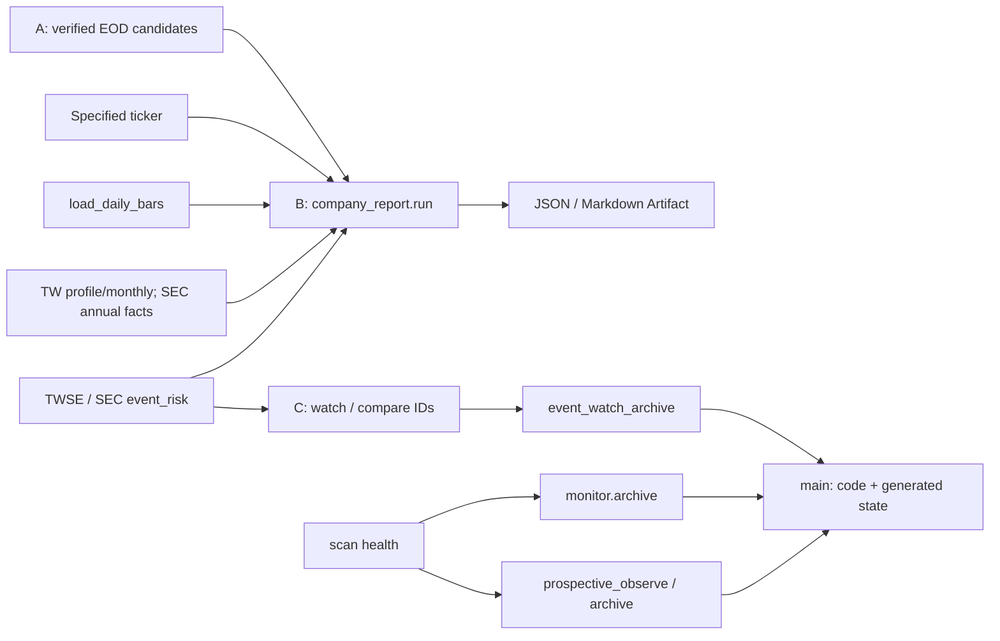
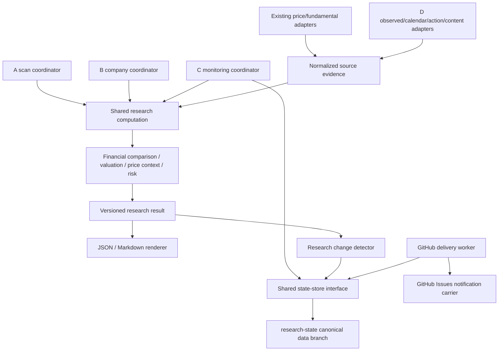
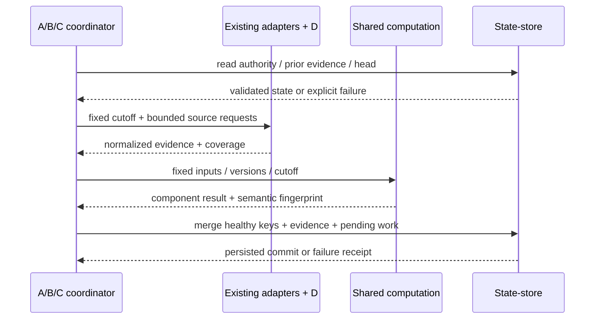
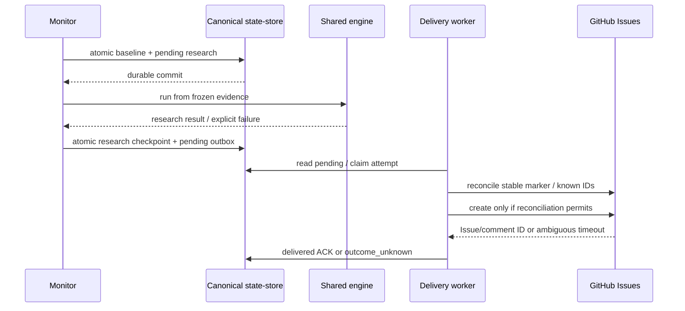
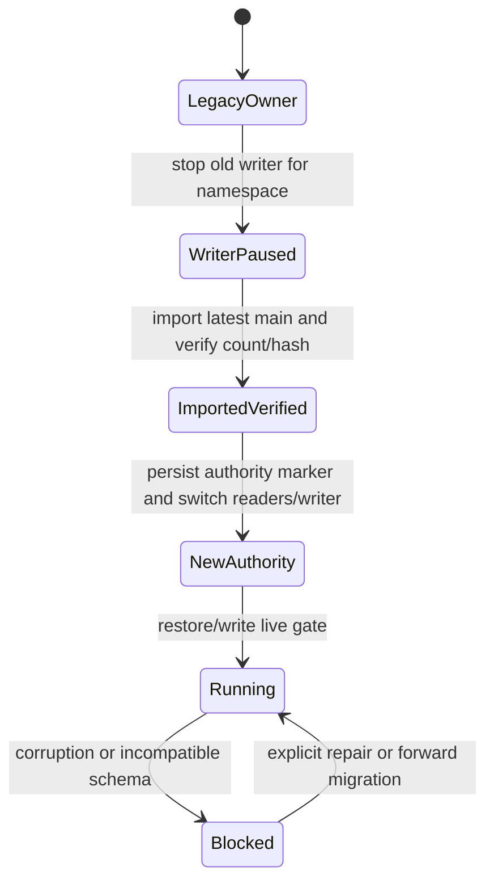

# Market Research — Shared Research System Design

Revision: 2026-10-19-r2。狀態：PROPOSED；獨立技術審閱 ACCEPT，產品待決事項仍須確認。
Current code baseline：`759947836c329edda8017805a8c6842fc8f337d8`。

本文件是獨立技術說明，整理同版 implementation spec 與工作規劃。CURRENT 表示上述基準 code 可證實；DECIDED 表示使用者已確認；PLANNED 表示本次工程提案；UNRESOLVED 表示尚須來源或產品決策。後續實作查核見 [現況與證據](research-system-evidence.md)，不將基準快照當成最新進度。文件合併不核准待決提案；技術審閱不等於功能、真實資料或排程已驗收。

## 1. Executive Summary

目標是以真實台美股資料支援 A 主動掃描、B 指定個股研究、C 持續追蹤，以及共用的 D 事件研究。系統應說明資料來源、估值假設、觀察條件、風險與失效條件。缺證據時回報 `not_evaluated`，不把研究訊號變成買入建議。

CURRENT：A 與 B 已共用公司研究流程，C 已能比較官方事件 ID，D 已有 TWSE / SEC 申報 metadata；完整財報、正式估值、通知與運作驗收仍未齊。最新公司報告的 `complete=true` 只代表 issuer name 與 technical 可取得；它不表示財報或估值充分（`scripts/company_report.py:95`）。

DECIDED：第一個完整工程里程碑維持 10 TWSE + 12 US pilot；先完成適用非金融業的端到端路徑。使用 GitHub Actions，不新增常駐伺服器。程式與設定透過 PR 保存於 main，durable research/operations metadata 使用一個 `research-state` branch，通知先使用 GitHub Issues。

PLANNED：沿用現有 adapters，收斂 shared research computation、明確時間/版本資料契約、共用 state-store、可恢復的研究工作與通知 outbox。這個改變先解決證據與可靠性，再累積策略驗證資料。

主要風險為台股歷史版本與發布時間、SEC 資料可用時間、資料保留權利、模型適用性，以及 Git commit 與 GitHub 通知之間沒有 transaction。來源、模型與價格契約各有 discovery gate，不以假資料補足。尚無可追溯人日估算，因此不提供總工時或承諾日期。

## 2. Requirements & Scope

### 已確認要求

- A/B/C 使用相同研究計算與資料語意；D 是共用能力。
- 數值附來源、period、unit、版本與可用時間證據；缺失與失敗不能轉成零或「沒有風險」。
- 原始申報、修訂、季度/累計、公司行動與 price basis 可區分；當時未可用資訊不得進入研究。
- 估值情境、技術價位與 ATR 只是研究證據。模型或執行價格契約未通過時，不生成合理價結論、stop/target 或風險報酬數字。
- 保留 Python 3.12、uv 與 lock；GitHub Actions 為最終驗證環境。
- 區分程式交付、live-data、live-operations、自然 schedule 與策略有效性。
- 不自動下單，不新增常駐伺服器，不把計畫中的驗證寫成 pass。

### 第一個工程里程碑的範圍

既有 pilot 內包含金融業與 SPY（`config/markets.yaml:13`、`:24`）。行情掃描仍可保留這些標的；company identity / instrument type / model eligibility 必須阻止把 ETF 當成一般 issuer 或把金融業套用一般 FCF。完整金融業模型、ETF 穿透估值、全市場/TPEx、持股管理、非官方新聞與外部通知不在此里程碑。

完整研究包括可追溯財報比較、業務/事件風險證據、符合適用性 gate 的估值情境，以及研究觀察與失效條件。這不構成策略已驗證或交易推薦。外部來源無法滿足契約時，明確降低該分項 readiness，而不是降低證據標準。

### 未決事項的處理

UNRESOLVED：台股實際 publication / revision history、正式非金融業估值模型、executable price/cost、來源再發布/保留權利。它們需產出來源或模型決策後才能實作對應數值功能。整體架構可以先接受這些明確 gates，不能宣稱它們已通過。

研究 state 是否保存足以重播的精簡 normalized values，而不只 Artifact index，仍待本輪確認。若只保留 index，本文件的長期 replay 目標必須相應縮限。

## 3. Current Architecture / Integration Context

圖中箭頭表示資料/結果流；沒有研究通知或正式估值已完成的含意。

- A 先驗證 health、coverage、session、strategy version 與 hash，再呼叫 B；二次下載不一致就阻擋關聯（`scripts/scan_company_research.py:21`、`:94`、`:109`）。因此應重用既有 seam，不重建研究系統。
- SEC 目前只有 annual `10-K/10-K/A` 的五項原始 metric 與 derived FCF；年度 observation 按 period 配對，`filed <= asof` 只有日期精度（`src/market_research/financial_history.py:10`、`:39`、`:69`）。
- TW fundamentals 直接取得最新 profile/月營收，沒有歷史 as-of 參數（`src/market_research/fundamentals.py:58`、`:86`）。它不是 IFRS 三表，也不能作歷史時點證據。
- valuation 是三年 median FCF 的硬編 10/15/20x sensitivity，狀態為 `illustrative_only`；SIC 6000–6999 已排除（`src/market_research/valuation.py:10`、`:27`、`:82`）。
- price context 有 completed-session、stale、price-basis 與 gap gate，固定不可執行（`src/market_research/price_context.py:28`、`:120`）。
- C 首次 baseline 不通知，缺失來源不覆蓋，seen IDs 是最多 2,000 的 bounded cache；尚無研究投遞（`src/market_research/event_monitor.py:42`、`:63`、`:90`）。
- 三個 data writers 都直接 push main；lock 也直接更新 main。smoke 的 branch push 可建立/關閉 synthetic Issue（`scripts/event_watch_archive.py:50`、`scripts/monitor.py:121`、`scripts/prospective_archive.py:39`、`.github/workflows/lock.yml:24`、`.github/workflows/ops-validation.yml:37`）。
- `monitor.archive` 切換呼叫端 checkout，之後才執行 prospective；main 若中途前進，後半段可能使用不同 revision。這是可由流程推導的風險，未確認實際發生（`scripts/monitor.py:111`、`.github/workflows/scan.yml:79`、`:87`）。

## 4. Target Architecture

### Module placement 與依賴方向

箭頭表示資料流或對 interface 的使用。engine 本身不寫 Git，也不建立通知；Actions coordinator 負責 IO、deadline 與流程。D 進入相同 evidence/engine，不維護另一份估值或研究 state。

### State ownership

| State / policy | 唯一 owner | Durable placement |
| --- | --- | --- |
| 程式、schema、設定與模型定義 | PR-reviewed repository | main |
| 暫存原始來源 payload / OHLCV | 既有 adapters / market-data module | runner temporary input；依權利可選 private replay |
| canonical selected research inputs / provenance | research snapshot module，透過 state-store 寫入 | research-state evidence namespace；精簡值保留決策待確認 |
| source-event baseline / bounded seen cache | event monitor merge policy | research-state events namespace |
| research comparison checkpoint / pending work | research monitoring coordinator | research-state research namespace |
| delivery ledger / pending outbox / acknowledged ID | notification coordinator | research-state delivery namespace |
| health history / immutable prospective receipt | 各 domain 的 append/merge policy | research-state operations / prospective namespaces |
| Git head、read/commit、CAS retry | 共用 state-store | 單一 Git interface，domain 不直接 push |
| 實際 Issue/comment 內容 | GitHub 通知載體 | GitHub；delivery status 仍以 ledger 為準 |

Git branch 是儲存位置，不是業務 state owner。shared store 處理競爭與原子 commit；baseline/immutable/delivery 各 policy 仍由對應 module 決定。多個 coordinator 不能各自實作 Git archive。

## 5. Design Realization & Interfaces

### Data contracts

| Contract | Consumer / implementer | 必要語意 |
| --- | --- | --- |
| Source evidence | adapters 產生；engine / replay 使用 | issuer、instrument、metric、value/null、unit/currency/scale、scope、period、duration/instant、source URL/document/version、retrieved_at、availability evidence / precision、parser/schema version |
| Derived fact | financial / valuation module 產生 | formula/model version、完整 input references、period/scope相容性、未計算理由；不把衍生值當申報原值 |
| Research request/result | A/B/C coordinator 呼叫 shared computation | fixed cutoff、normalized input identity、code/parser/model/config versions、分項 coverage/readiness、evidence references、limitations |
| Research change | detector 產生；monitor 消費 | issuer、old/new semantic fingerprints、changed source documents、new-period / revision / coverage / model-change 分類、需要重新研究的原因 |
| State read/commit | coordinators 使用；Git-backed store 實作 | namespace authority、head、schema、read status；expected head 下 domain merge 與 bounded fast-forward retry，輸出 persisted commit 或明確 failure |
| Delivery | monitor / worker 使用 GitHub adapter | stable delivery key、research evidence、pending/outcome_unknown/delivered/blocked 狀態、attempt、Issue/comment ID與marker、ack來源 |

上述是 PLANNED contract 的最小必要內容，不是假稱已存在的 Python types。具體 signature 在垂直實作中按既有 patterns 定案。

### Time 與版本

`period_end` 是數據所屬期間，`filed` 是來源申報日期，`accepted_at` 是受理時間，`published_at` 是有證據的公開時間，`first_seen_at` 是本系統首次觀察，`retrieved_at` 是當次擷取。這些欄位不得互相代填。

歷史 cutoff 只能接受有證據的不晚於 cutoff 的 availability，或當時已持有的 snapshot。date-only 不補為當日 00:00；SEC acceptance 不當作 exact publication。TW 出表日期不作財報公開時間。無法證明就 `not_evaluated`。此保守契約與現有 annual date gate 有相容性影響，需 schema 與 characterization 驗證。

年度/季度/累計/TTM按實際 start/end 與 scope 對齊。累計相減只在可比較版本成立時進行；Q4 與 TTM 也保存全部 derivation inputs。修訂不覆寫原先持有證據。

### Identity 與 replay

PLANNED：source document identity 與 normalized content hash 決定 evidence version；研究結果另保留 cutoff 與執行版本作 trace。變更偵測使用 semantic fingerprint，排除單純 generated/retrieved timestamp 改變；cutoff 前進但 inputs/gates 不變不產生假市場事件。時間前進造成 stale gate 改變則是明確 coverage/readiness change。

model/schema 變更走 migration/rebaseline review，不當成新財報。delivery key 由穩定 change identity 與通知契約產生，不以 run ID 當事件 identity。

replay 只承諾持有且有權保留的 inputs。精簡 financial/事件 facts 若保留可重算對應推導；未持有完整行情時，不能重算技術指標或策略績效。Artifact index 過期時不能偷偷下載最新資料冒充舊 snapshot。

US 先行路徑不自動覆蓋 TW。台股 cash/debt/shares 分類、幣別/scale、模型適用性、真實財報差異與 C 觸發必須有 source-specific 整合與驗收承接；單純 TW 財報正規化或固定輸入 parity 不能替代。完整里程碑等待這些證據，模型不適用時回到明確決策 gate。

### Output compatibility

現有 v3 JSON/Markdown 先 characterization，再將 computation 與 renderer 分離。新 schema 分開 pipeline、source coverage、financial、valuation、events、readiness、persistence、delivery；保留 legacy `complete` 意義並逐步引導 callers，不將它改名後偷偷擴大成功語意。

## 6. Runtime Behavior

### 來源到研究

來源 transient timeout/429/5xx 可在 job deadline 內有限 retry，遵守來源 policy/Retry-After；身份、schema、時間契約錯誤不盲重試。某 symbol source partial 不抹除該 baseline；其他已驗證健康 symbol 可保存，最終 run 仍回報 partial。store 整體不可讀或 corrupt 不初始化新 baseline。

### 事件、研究與通知的 failure windows

首次 baseline 不 enqueue 歷史事件。baseline 前進時，pending research 必須同 commit 保存；研究失敗留待恢復。研究 checkpoint 前進時，pending outbox 必須同 commit 保存，避免「已比較」但未留下通知工作。

worker 使用 durable attempt claim 與同一 concurrency policy 減少並行。crash/timeout 後先依 marker/已知 ID 對帳；已送出而 ACK 失敗不能直接再送。marker/內容被刪改或權限不足進入明確 blocked/manual reconciliation，不把無法判定當 delivered。仍可能有極端重複；這是可恢復投遞嘗試，不是 exactly-once 或收件保證。

job 取消或 deadline 到期不回滾已保存 evidence；下次成功 reconciliation 繼續 durable pending。concurrency group 可能遺失排隊觸發，不能代替 durable backlog / ref check。GitHub 整體服務故障且無外部 heartbeat 時，系統無法保證即時發現或通知。

### State commit 與固定 revision

store 在隔離 Git 工作目錄產生 head 的 child commit，普通 fast-forward push / `force=false`。遇競爭重新讀最新 head，讓 domain policy 重算受影響 key，最多三次；無法合併、stale 或 incompatible 時明確拒絕，不 force overwrite。

同一 key 的 prospective 不同 payload 永遠是 conflict；相同 payload可重跑。event/research只接受合法時間順序，通知ledger不遺失已知ACK。分析 checkout 固定當次 code SHA；state IO 不切 branch，因此不會把後續分析換成較新 main。

## 7. Migration & Implementation Phases

| Phase | 目標與主要變更 | Gate / 可觀察交付 |
| --- | --- | --- |
| Evidence 與執行基礎 | 統一來源/時間/eligibility，先以既有 health history 驗證 shared store；同時查證 SEC/TW/calendar/actions | compact state branch tree、main 不變、restore/race/failure receipts；官方來源可行性與未決限制 |
| 財報與共享研究 | 年度/季度/修訂接入同 computation，分項 readiness、retained evidence、A/B/C parity | 真實非金融業 TW/US facts對帳、no-lookahead、相同 inputs核心結果一致；無權保留的來源阻擋 |
| 事件與持續追蹤 | observed/calendar/actions/content facts、財報差異、pending research、GitHub outbox | baseline不通知、來源失敗不遺失工作、重跑/timeout後可恢復、通知marker對帳 |
| 估值與研究計畫 | 先選模型/價格/成本契約，再接入情境/敏感度/失效與觀察條件 | 有來源的假設與獨立worked examples；不適用或證據不足明確not_evaluated |
| 遷移收斂與正式運作 | 所有state writer/reader與lock/smoke處理後才main protection；自然雙市場排程驗收 | 權限拒絕測試、固定code/cohort、due-slot證據、coverage/persistence/delivery/recovery；不由dispatch替代 |

這些 phases 是工程成果分組，不表示所有前一 phase 工作都阻擋下一 phase；獨立來源調查與 workflow 規範可以並行。

### Namespace cutover

每個 namespace 在切換前只有 legacy owner，切換後只有 new owner。authority marker 保存 legacy source SHA、import hash/count、schema與cutover evidence。全部 reader/writer都切換後才宣稱該 namespace完成；任何新 state缺失不得回退舊main並誤初始化。

legacy tracked metadata保留唯讀，不自動刪除。rollback採停止writer、確認latest head與明確修復/forward migration；不reset statebranch、不讓舊writer重啟覆蓋新資料。dependency lock屬程式資產，改走PR而不是搬入state。

prospective新cohort釘code/provider/calendar/config，舊cohort不回填或合併；比較績效前需重新確認樣本與公司行動方法。main protection由有權限者在完整cutover後設定，本次不自行啟用。

## 8. Estimates & Risks

未有獨立來源支持人時/人日或calendar duration；目前僅能確認每個垂直工作應可在單次Agent context內完成，來源不成立時需重新切分。自然排程與新資料累積的等待時間不能算成已完成工程工時。

| 風險 | 影響 | 停止 / 重估條件 |
| --- | --- | --- |
| TW official publication/history不完整 | 無法保證歷史as-of或修訂比較 | 來源gate失敗，縮限為可證實的prospective資料；回spec定案 |
| SEC acceptance不等於public availability | 同日歷史判讀可能lookahead | 無可用時間證據則not_evaluated；fixture與runner核對 |
| 再發布/保留權利未確認 | 公開state不能保存必要inputs | 該source不持久化；重估replay範圍 |
| metadata與ledger持續增長 | Git操作與job deadline惡化 | 記錄state大小/讀寫時間；超出實測預算時停止擴universe並重新決定storage/retention，不默默清除ledger |
| 模型/價格資料不足 | 不能產生有依據的估值/ratio | 保留illustrative或not_evaluated；禁止猜假設 |
| GitHub通知沒有跨系統transaction | crash window可造成不確定投遞 | marker對帳、durableattempt、blocked狀態；不承諾exactly-once |
| 排程/平台故障 | 遺失cron或延遲研究 | watchdog/reconciliation與manualrecovery；無外部heartbeat仍有盲區 |
| 多Agent認領競爭 | 相同模組重疊修改 | Assignee+session留言後重新讀取；無原子鎖保證，衝突先協調 |

## 9. Verification & Acceptance

### VERIFIED current evidence

基準SHA的 Unit tests、push EOD scan與TW company report在GitHub成功；已下載scan/companyArtifacts核對。scan為22/22、errors=0、signals=0；company report仍是financial unavailable、valuation not_evaluated。現有 tests 涵蓋 annual future restatement/period mismatch、price stale/no-lookahead、watch baseline/failure與watchdog/prospective guards。

這些證據不涵蓋SEC真實來源、官方watch持久化、研究通知、新targetcontracts或正式cron。兩個source/watch live workflows查核時均沒有run。原型或計畫中的tests不列為pass。

### PLANNED validation

| 層級 | 觀察什麼 | 不可替代的下一層 |
| --- | --- | --- |
| Unit | source時間/period/revision、模型eligibility、hash/change、狀態轉移 | 不代表外部來源或GitHub權限可用 |
| Integration | real bare Git race/restore/conflict/main unchanged；timeout-after-create；相同snapshot A/B/C parity | 不代表真實issuer欄位或自然cron |
| Live-data | 全新runner取TW/SEC非金融業與修訂/公司行動案例，欄位/時間/單位對帳 | 不代表長期可靠或策略有效 |
| Live-operations | 真實data branch、失敗權限、通知marker與ACK復原 | 不代表scheduler實際觸發 |
| Natural schedule | 部署後明確future due slots，至少連續兩個各市場eligible slots；實際run、sourcecoverage、state/delivery receipts、recovery | 不代表投資績效；無自然事件時只稱通知受控測試通過 |
| Strategy evidence | frozen prospective資料、交易成本/公司行動/偏差與獨立樣本方法 | 不自動升級為買賣推薦 |

所有驗收都記錄最新codeSHA、event type、RunURL、input/model/schema版本、statecommit與實際Artifact內容。失敗讀真實log後分類修正，不能沿用舊commit綠燈。PR交付與自然排程可分開等待，未觀察的gate保留未完成。

Mermaid已作文字與方向檢查；本版本尚未宣稱經renderer驗證。進一步修改來源決策時先更新有效spec，再有限範圍同步本設計。
