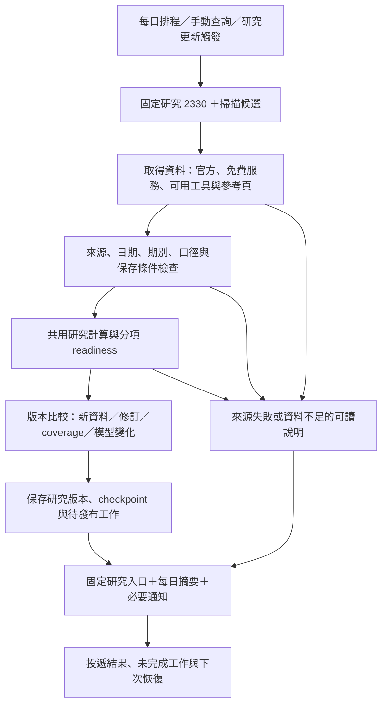

# 台股優先、可觀察的研究 workflow — Implementation Spec

Revision: 2026-10-19-tw-r1。狀態：使用者已確認產品方向、完整 ticket 粒度、blocking edges 與驗收方式，並授權發布 GitHub Issues、列為最高優先。
本文件是既有 Research System spec 的台股交付修訂；調整台股的優先順序、來源選擇、feedback 與驗收方式，不代表下列新能力已實作。GitHub Issues / PR / Actions 持續作為進度來源。

## Problem Statement

目前可執行盤後掃描與初步個股報告，但使用者難以看出一天的工作改善了什麼。0 候選時沒有固定個股研究成果；公司身分來源失敗可能沒有報告；研究報告、來源 coverage、保存與通知的成功語意分散，且缺少可比較版本與固定成果入口。
台股財報、估值或美股 SEC 的個別 gate 容易被理解為整條產品流程受阻。需要先提供可觀察、可恢復的台股 workflow，再逐項補齊研究能力。

## Solution

先以 2330 建立每日固定研究、手動查詢、研究保存、前後變化與必要通知的完整路徑。即使沒有技術候選，或某項來源不足，仍交付目前可用結果及明確缺口。完成單一標的的運作證據後，再擴至既有台股 10 檔。
沿用 GitHub Actions 執行、Summary / Artifact 呈現、research-state 保存允許的精簡證據與工作狀態、GitHub Issues 作固定研究入口與變更通知。研究入口與開發 tickets 是不同用途；開發進度仍由 tickets / PR 推導。

## User Stories

1. 作為研究使用者，我要先完成台股 workflow，以便不必等待 SEC 設定或美股功能。
2. 作為研究使用者，我要先以 2330 驗收整條流程，以便確認每個部分真的能連起來。
3. 作為研究使用者，我要在沒有掃描候選時仍取得固定個股研究，以便每天有可閱讀成果。
4. 作為研究使用者，我要能手動指定台股 ticker，以便在排程之外重新研究。
5. 作為研究使用者，我要從固定入口取得最近一次研究，以便不用搜尋多個 Actions runs。
6. 作為研究使用者，我要看到報告的資料日期、評估時間與執行時間，以便判斷新鮮度。
7. 作為研究使用者，我要知道本次是否執行、來源是否齊全、保存是否成功及通知是否送出，以便辨識失敗位置。
8. 作為研究使用者，我要在公司身分來源失敗時仍看到可讀的錯誤結果，以便知道問題與受影響標的。
9. 作為研究使用者，我要區分沒有候選、來源失敗、資料不足與尚未實作，以便理解報告缺口。
10. 作為研究使用者，我要相較上次看到有證據的變化，以便快速決定是否需要詳讀。
11. 作為研究使用者，我要重抓相同內容時不產生假變化，以便避免無意義通知。
12. 作為研究使用者，我要看到來源退化或資料過期，以便不把舊資料誤認成新資料。
13. 作為研究使用者，我要知道採用資料的原始供應者與取得方式，以便核對官方或第三方資料。
14. 作為研究使用者，我要每項能力都調查免費來源與可重用 open source，以便降低取得成本與維護負擔。
15. 作為研究使用者，我要能利用 Yahoo 股市頁面作參考，以便直接核對市場資訊。
16. 作為研究使用者，我要知道免費方案的帳號、token、額度及欄位限制，以便不在部署後才發現不能使用。
17. 作為研究使用者，我要看到年度三表及財務比較，以便了解公司的歷史營運與現金流。
18. 作為研究使用者，我要季度、累計與 TTM 分開，以便不把累計值當單季。
19. 作為研究使用者，我要保留同期間的修訂證據，以便辨識更正與新一期資料。
20. 作為研究使用者，我要數值附期間、單位、合併口徑及來源，以便避免不可比資料。
21. 作為研究使用者，我要當下研究可使用本次取得且通過檢查的資料，以便不因缺乏歷史首次公開時刻而停掉整份報告。
22. 作為歷史研究使用者，我要 cutoff 只使用可證實當時可得的資料，以便避免 no-lookahead 違規。
23. 作為研究使用者，我要看到官方公告與可核對的新聞參考，以便自行理解事件。
24. 作為研究使用者，我要財報／法說行程附確認程度及更正狀態，以便不把推測日期當官方行程。
25. 作為研究使用者，我要除權息、分割與股數口徑明確，以便理解價格及每股數值的限制。
26. 作為研究使用者，我要估值先有模型與假設依據，以便能檢查情境是否適用。
27. 作為研究使用者，我要估值情境、技術觀察與交易價格分開，以便理解每個數字的用途。
28. 作為研究使用者，我要來源不足時保留 not_evaluated 與原因，以便不被補零或猜測值誤導。
29. 作為研究使用者，我要研究變更可觸發重新研究，以便不必每次手動重跑。
30. 作為研究使用者，我要首次 baseline 與無變化不重複通知，以便維持通知品質。
31. 作為研究使用者，我要保存與通知失敗後仍能恢復，以便不遺失待處理工作。
32. 作為研究使用者，我要來源允許的必要精簡證據可長期比較，以便不依賴會過期的 Artifact。
33. 作為研究使用者，我要未獲准保留的來源清楚限制比較範圍，以便知道哪些舊結果無法重算。
34. 作為研究使用者，我要自然排程與手動驗收分開，以便確認每天自動執行的承諾。
35. 作為研究使用者，我要台股第一階段的驗收不依賴美股 gate，以便先使用已完成市場。
36. 作為研究使用者，我要擴至既有 10 檔時逐檔顯示 coverage 與適用性，以便不讓單一來源或金融業模型缺口拖垮其他標的。
37. 作為工作交付者，我要每張 ticket 都有可演示成果、真實 blockers 與驗收證據，以便從新 context 接續。
38. 作為維運者，我要掌握未執行、失敗、卡住與待恢復工作，以便知道何時需要介入。

## Implementation Decisions

### 已確認的範圍與交付方式

- 台股優先；第一個標的是 2330，之後擴至既有台股 10 檔。SEC_USER_AGENT 與美股驗收不是台股依賴。
- 先提供 workflow 的可觀察端到端路徑，再逐步補齊財報、事件與估值；某項能力不足時，該部分明確降級，其他已驗證結果仍可交付。
- 每日固定研究不依賴技術候選命中。既有 scan universe 與策略啟用規則不因本規劃自動改變。
- 保留 Remote-first、Python 3.12、uv.lock、GitHub Actions、共用研究計算與唯一 Git state-store 的既有方向。
- 固定研究入口使用 GitHub Issue，摘要與最近結果可直接閱讀，並連回當次 Run / Artifact。日常摘要更新與有意義研究變更通知分開；不逐日新增開發 Issue。
- 本次交付為 spec 與可交接 tickets；功能實作由後續各 ticket 交付。
- 本批台股 workflow 為最高優先項目；執行仍按 native blockers 與認領狀態，先交付可獨立開始的報告 feedback、免費財報來源實測與排程診斷。

### 免費資源與來源採用

- 每項能力記錄可用的免費官方資料、服務方案、open source 及網頁參考；來源選擇以實際 coverage、取得可靠性、條件與維護成本為準。
- TWSE 現有行情、公司資料與月營收先重用；財報評估官方／issuer IR、FinMind 等免費路徑；Yahoo 頁面、yfinance 與其他工具保留明確用途與限制。
- 開源程式授權與資料使用條件分開。採用表記錄是否需帳號／token、免費額度、可取得欄位、限制與替代來源。
- 公開可讀網頁不等於可直接部署無限制 scraper；明確限制與本次未驗證事項分開。來源受限只阻擋依賴該來源的能力。
- 來源採用以前置少量 runner 實測及獨立欄位對帳完成，不以文件存在、搜尋索引、HTTP 200 或套件安裝成功代替資料驗收。
- 不因第三方來源存在而改寫成官方原始申報；報告保留 source identity、取得方式、期別及必要交叉核對結果。

### 輸出與 feedback 契約

- 研究結果分開表示執行、來源 coverage、研究各部分 readiness、保存及發布／通知結果。保留舊 complete 的既有意義與相容性。
- 使用者摘要回答：這次完成什麼、資料到哪一天、相較上次變什麼、哪些部分受阻及影響。開發 ticket metadata 不混入研究內容。
- 工作程序已開始且能寫出結果時，正常、來源失敗、缺資料、計算失敗、0 候選、無變化均有可讀報告與 machine-readable receipt。
- runner 未啟動、工作未觸發等無法自行寫報告的情況，由排程觀察及固定入口揭露最後成功時間與過期狀態。
- 舊成功報告可以保留，但來源日期、stale 與最近失敗必須可見；失敗不得把舊結果冒充新結果。

### 研究證據、比較與唯一 state owner

- 使用者同意在公開 research-state 保存來源允許公開保留的精簡證據；必要數值、期別、單位、source identity、觀測時間、推導與版本依來源條件選擇。
- 未確認保存條件的部分只保留允許的 metadata／連結，清楚標記無法比較或重播的範圍；不在本里程碑新增私人儲存。
- 共用 store 維持唯一 Git interface。研究 coordinator 擁有研究 namespace 的 snapshot、比較 checkpoint、pending research、發布與通知 outbox；來源事件 namespace 仍由既有 event owner 管理。
- 既有 store 是 JSON metadata 契約；新增精簡研究證據須有明確 allowlist、大小預算與 schema，不能把完整行情、公告全文或整包第三方 response 塞入既有 metadata。
- 使用單一研究 namespace 的原子 commit 保存研究 checkpoint 與 pending work；沿用 bounded fast-forward retry、固定分析 checkout 與 explicit namespace initialization。
- 事件持久化與研究觸發透過 canonical source version／研究消費 checkpoint 對帳；即使來源 baseline 已前進，下次仍能發現未完成研究。研究 checkpoint 不是第二份來源 baseline。
- 比較使用 normalized content、資料期間、來源版本及模型／schema identity；單純抓取時間與 Run ID 改變不算研究變化。新資料、修訂、coverage 退化與模型變更分別呈現。
- main 保持程式交付途徑；新研究 state 不寫 main，也不切換分析 checkout。舊 operations / events / prospective owners 不被新功能覆寫。
- 不自動清除舊研究證據；只保留精簡資料並觀察容量，後續清理依既有精確路徑授權規則另行處理。

### 研究、時間與估值契約

- period、filed／出表日期、來源 publication、系統 first_seen 與 retrieved time 分開。
- 執行開始時間與研究 cutoff 分開。當下研究先完成必要輸入取得，再固定可支持這批 inputs 的評估 cutoff；指定歷史 cutoff 不得因之後抓到資料而向後移動。
- 當下／prospective 研究可以使用當次實際取得且通過檢查的資料，記錄 first_seen 與 limitations。缺乏歷史 publication 證據只限制歷史 as-of 判讀。
- 歷史研究不以目前網頁或新抓資料回填過去；date-only 與未知時間不補成精確 publication time。
- 年度、季度、累計與 TTM 按 issuer、期間、幣別／scale、合併口徑與版本對齊；修訂保留原本持有證據。
- 財報、行程、公司行動、新聞與估值各自有適用性與來源 coverage，不能互相代替。
- 估值先以真實 2330 inputs、適用模型、可追溯假設與獨立 worked example 完成決策，再接情境與敏感度；未通過時維持 not_evaluated。
- 金融業與其他不適用標的保留行情與事件觀察；不套用一般業模型。ATR、支撐壓力與估值情境不自動成為買進價、停損或目標價。

### 發布、通知與恢復

- 固定報告發布與研究通知使用同一 outbox／GitHub delivery adapter，依 publication kind 區分摘要更新與變更通知；不各自建立另一套 delivery state。
- snapshot／比較 checkpoint 與待發布工作同 commit 保存，外部發布成功後保存 ACK。
- 重試先以穩定 marker／既知 Issue 或 comment identity 對帳；timeout 後結果未知時不直接重送。
- 首次 baseline、無變化、純時間更新與技術候選未命中不產生研究變更通知。缺來源屬 coverage／維運問題，不包裝成財報事件。
- Issue 被刪改、權限不足或無法判定的發布結果需明確阻塞與修復入口；不宣稱 exactly-once 或實際收件保證。

### 既有工作與排程邊界

- 重用已交付的 state-store、event baseline、共用計算與既有 tests。
- 既有台股官方三表 discovery 仍保留其官方來源驗收範圍；新增免費／第三方路徑以獨立 source contract 決定，不讓官方 XBRL 缺口阻擋所有當下研究。
- 既有自然排程 acceptance、prospective cutover、workflow／branch cleanup 持續承接原範圍；不重開已完成實作或替其他執行者關閉工作。
- 排程缺席先查真實 workflow enabled 狀態、due slots、run event 與延遲證據，再決定修復；不預設 GitHub 故障或 cron 寫錯。
- 台股 operational acceptance 有獨立結果，不因既有雙市場 acceptance 尚待美股而否定台股已取得的證據。
- workflow 變更前核對所有寫入、Issue 通知、prospective 與下游 side effects；正式觀察不由 branch push 或 dispatch 冒充。
- 不為本規劃合併所有 workflow、刪除分支、重做 production bootstrap 或啟用 branch protection。

## Testing Decisions

### 對使用者可觀察的最高層 seam

1. 個股研究／每日研究 coordinator：給定 ticker、cutoff 與來源，驗收實際報告、摘要與 receipt；重用現有 company report、候選 coordinator 與純研究計算 seam。
2. 研究保存／恢復：以真實 bare Git integration 驗收 snapshot、latest pointer、pending、重跑／競爭／失敗與 main／分析 revision 不變。
3. GitHub delivery adapter：以實際外部結果及獨立 fake adapter 驗收發布、timeout-after-create、對帳與 ACK；live 測試另保存真實 Issue／comment identity。
4. 自然排程：驗收真正 event=schedule、due slot、source session、run SHA、state commit、成果入口與需要時的通知；人工先行驗收另外標示。

### 必要情境與 evidence

- 正常；公司身分／行情／營收／公告任一來源失敗；缺三表／模型；0 候選；無變化；stale；來源切換；不相容版本。
- 來源只影響依賴它的部分，健康標的不因另一標的失敗而遺失已驗證結果。
- characterization 保留既有輸出與可注入 seam；行為改動包含 regression，預期值來自已知 fixture、原始財報或獨立手算。
- no-lookahead、累計轉單季、年度／季度與股數／價格基準，各有獨立 oracle。
- 研究 checkpoint、pending work、outbox、重試與 concurrency 有 crash-window integration；不以逐步函式 mock 代替外部可觀察行為。
- Unit / integration / live-data / live-operations / natural schedule 證據分開；查核最新 SHA，附 Run URL、Artifact、資料 coverage、state commit 與限制。
- 核心 2330 workflow 至少觀察兩個連續 eligible TW 自然 slots；真實新事件尚未發生時，通知只能稱受控復原驗證，保留自然事件驗收限制。
- 本規劃文件只做內容、連結、依賴 DAG 與 scope 對帳檢查，不宣稱尚未執行的新功能已通過 runtime。

## Out of Scope

本輪不實作功能或變更正式排程／state／GitHub 設定，不自動合併進行中的 PR。
美股完成度、SEC 設定、全市場與 TPEx 擴充、金融業專用估值、ETF 穿透估值、持股管理、即時交易、自動下單、付費資料採購、新的常駐服務／網站、私人儲存與外部通知服務，均不列入本次台股交付依賴。
掃描候選數量與投資績效不是工程成功條件；工程驗收不宣稱策略有效。

## Further Notes

- 已確認：台股優先、先 2330 的每日固定研究／手動查詢／差異摘要，再擴 10 檔；允許來源條件下的精簡證據公開保存；調查各部分免費資料、open source 與 Yahoo 網頁。
- 使用者已確認完整 tickets 粒度、真實 blocking edges、驗收 seam／交付入口與批次發布；來源採用與估值模型仍依個別 gate 驗收。
- 來源取得與估值模型是有明確輸出與適用條件的工作；未選定不補猜，也不讓它們成為無關 workflow 能力的 blocker。
- 交付順序為：先可讀成果與固定入口／每日研究，再補資料與模型；事件重新研究／通知、排程診斷可依真實依賴前進；最後取得單一標的運作證據並擴大。
- 初始本地 code 基準為 main@4cff1fb313e09935b25c5588f3c50fecc1711d7d。實作前重新查核 origin/main、Open PR、Issue 認領及 Actions。
- 來源調查見 [台股免費財報來源](../TW_FREE_FINANCIAL_SOURCES.md)、[台股免費行情與事件來源](../TW_FREE_MARKET_EVENT_SOURCES.md)。調查筆記的文件／網頁查證不等於 runner live acceptance。
