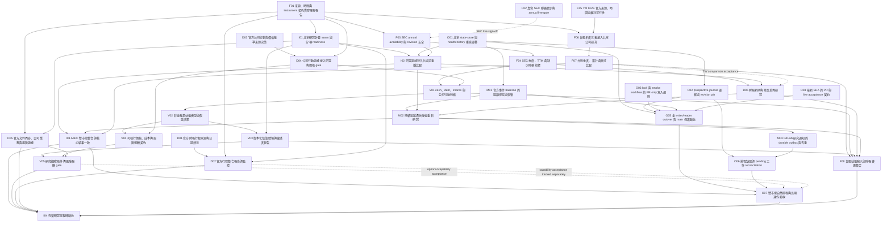

# Research System — Epic / Issue 發布草案

Revision: 2026-10-19-r2。以下代碼是本次規劃的識別名稱，**不是 GitHub Issue 編號**。粒度與依賴已獲使用者確認，批次發布仍待 compact evidence / discovery gates 決策。已單項發布的 O01 重用 [Issue #12](https://github.com/iceboxi/market-research/issues/12)，M01 重用 [Issue #9](https://github.com/iceboxi/market-research/issues/9)；operations 自然排程 gate 為 [Issue #14](https://github.com/iceboxi/market-research/issues/14)，後續 O07 引用而不複製。

這是初始工作拆分提案，不持續手動更新任務狀態；發布後狀態以 GitHub Issues / PR / blocking links 為準。spec 草案見 [research-system-spec.md](../design/research-system-spec.md)，獨立設計見 [research-system.md](../design/research-system.md)，現況證據見 [research-system-evidence.md](../design/research-system-evidence.md)。

## 結構與發布規則

一個 spec parent，六個 Epic 作其 sub-issues，各工作作所屬 Epic 的 sub-issue；native blocked_by 只記真實 start blockers。先建全部工作取得 database IDs，再加 native edges；不使用假的 #101 等 placeholder。Epic 是分組，不應成為全部 child 的 blocker。

implementation、discovery、human、acceptance 是內容性質，不另造一套 status labels。discovery 有明確問題與可驗證交付時可 ready-for-agent；human 用 ready-for-human。下游若需未完成的模型/來源決策，用 needs-info 或 native blocker，不能只因已有清單就當 Ready。

每張發布的 Issue 都展開以下共同契約：以 spec revision 與設計對應章節為 Design Reference；正常、缺失資料、來源失敗與必要的 no-lookahead tests；輸出schema、provenance、side effects；最新SHA/RunURL/Artifact；不聲稱未執行驗收；分開unit/integration/live/schedule。認領與交付依 docs/agents/issue-tracker.md。每個Issue同時保留下面的目標、input/output、specific checks、dependencies與既有接點，因此不依賴原始對話。

## Epic 範圍

| Epic | 目標 | 既有成果沿用 |
| --- | --- | --- |
| E1 — Research Foundation | Research Foundation 的可獨立驗收工作 | SEC annual normalization、TW profile/月營收、共用行情 |
| E2 — Valuation & Risk | Valuation & Risk 的可獨立驗收工作 | illustrative P/FCF、sector gate、price context |
| E3 — Event Intelligence | Event Intelligence 的可獨立驗收工作 | TWSE/SEC observed event adapters |
| E4 — Research Integration | Research Integration 的可獨立驗收工作 | A 候選直接重用 B 的 company_report.run |
| E5 — Monitoring & Notification | Monitoring & Notification 的可獨立驗收工作 | watch baseline、新 ID 比較、source failure guards |
| E6 — Operations & Acceptance | Operations & Acceptance 的可獨立驗收工作 | Unit tests、source acceptance入口、health/watchdog/prospective |

## 依賴圖

虛線為 live sign-off 或市場擴充 gate，不是假 start blocker；各工作內另有詳細說明。

## 建議執行順序

先做 O01（shared store + 一條真實 history 路徑）、F01（evidence/time/eligibility）、F02（人工 SEC contact）、F05 / D01 / D03（來源 discovery）；O03 / O04 可在不碰同檔的獨立工作範圍並行。完成 blockers 才進 SEC/TW 財報、既有事件 migration、shared engine / replay，再進研究變更與通知。估值與價格模型先過 discovery，再實作。最後保留獨立 cutover / schedule acceptance。

本次不替未決模型、不可證實來源或正式自然schedule勾選完成。每個single-market先行slice與雙市場擴充gate均明列，不以US通過宣稱TW完成。策略有效性/完整金融業模型不屬於此第一個工程里程碑；目前既有research gates繼續阻擋自動啟用。

## E1 — Research Foundation

### F01：來源、時間與 instrument 契約貫穿既有報告

性質：implementation。Blocked by：None，可開始。

**Goal / Scope：**在既有公司報告加入可驗證的 fact provenance、availability precision 與 instrument/model eligibility；保留既有輸出相容性。

**Input / Output contract：**輸入為 TWSE/SEC normalized facts 與 evaluation cutoff；輸出保留 value/null、unit/scale/currency、scope、period、document/version、retrieved_at、available-at evidence 與 source status。未知精度不填時間。

**Acceptance criteria：**

- [ ] 以一個 TWSE 與一個 SEC fixture 走既有報告；金融業/ETF/未知 issuer 明確 not_evaluated，行情觀察仍可保留。
- [ ] date-only、accepted time、first_seen 與 retrieved time 不混用；future / missing provenance fail closed。
- [ ] 契約版本升級與 legacy complete 意義有 compatibility fixture。

**既有接點 / Handoff：**現有 company_report、fundamentals、financial_history 與對應 tests；不建第二套 adapters。 Design Reference：獨立設計的 Design Realization & Interfaces / Data contracts；發布時附固定文件revision，依有效spec實作。

### F02：真實 SEC 聯絡資訊與 annual live gate

性質：human。Blocked by：None，可開始。

**Goal / Scope：**設定真正的 SEC contact identity，使用既有 SEC-only workflow 驗證 annual ingestion。

**Input / Output contract：**使用者提供真實 name/email 至 repository SEC_USER_AGENT；Agent 不生成聯絡資料、不把值寫進文件或 log。輸出最新 SHA/Run URL/coverage receipt。

**Acceptance criteria：**

- [ ] 新 runner 取得 AAPL issuer identity 與六類必要 annual categories；逐欄檢查 provenance。
- [ ] 缺 secret、403/429、缺欄位均顯示失敗，不能 skip 後回報成功。
- [ ] ingestion pass 與三年估值 gate 分開記錄；不得以此宣稱正式估值成立。

**既有接點 / Handoff：**既有 SEC live annual financial acceptance workflow；不要求本地 Python。 Design Reference：獨立設計的 Design Realization & Interfaces / Data contracts；發布時附固定文件revision，依有效spec實作。

### F03：SEC annual availability 與 revision 安全

性質：implementation。Blocked by：F01。

**Goal / Scope：**修補 annual financial as-of 僅依 filed 日期的限制，提供可證實的 snapshot 選擇。

**Input / Output contract：**輸入為 companyfacts、submissions/filing evidence 與 cutoff；輸出每一期間當時可用版本。accepted time 不冒充 publication；無歷史證據就 not_evaluated。

**Acceptance criteria：**

- [ ] 同日尚未公開、未來 restatement、部分 amendment 與不同 timezone fixtures 均不倒灌。
- [ ] 新舊同期間資料以來源版本區分，保留最初觀察與後續修訂。
- [ ] 真實 filing/accession join 在 runner 驗證；F02 是 live sign-off gate，不阻擋離線實作。

**既有接點 / Handoff：**延伸已存在 annual_history / normalize_sec_history 與 future-restatement tests。 Design Reference：獨立設計的 Design Realization & Interfaces / Data contracts；發布時附固定文件revision，依有效spec實作。

### F04：SEC 季度、TTM 與缺少財務指標

性質：implementation。Blocked by：F03。

**Goal / Scope：**以一個非金融業 US issuer 完成季度/TTM 財務表與報告，不以累計值冒充單季。

**Input / Output contract：**新增 EPS、gross profit/margin 與後續估值所需財報欄位；按 duration、scope、currency、版本對齊。TTM/差分保留全部輸入，缺季不推算。

**Acceptance criteria：**

- [ ] Q1/Q2/Q3、52/53-week、累計 CF、Q4 derivation 與 amendment 的獨立 fixtures。
- [ ] 缺欄位/不同口徑/不相容修訂返回 not_evaluated，不默認零。
- [ ] AAPL 真實 annual/quarter statement 對帳與 cutoff 前後驗收；F02 未通過不得關閉 live gate。

**既有接點 / Handoff：**重用既有 comparison / SEC normalization，不以 frame 最新值取代 as-of。 Design Reference：獨立設計的 Design Realization & Interfaces / Data contracts；發布時附固定文件revision，依有效spec實作。

### F05：TW IFRS 官方來源、時間與權利可行性

性質：discovery。Blocked by：None，可開始。

**Goal / Scope：**查證一般業官方年度/季度三表可取得性、合併口徑、單位、實際版本公開時間與再發布權利。

**Input / Output contract：**產出 source contract、可重播 fixture 取得方式、revision/publication evidence、unsupported 清單與 stop conditions；不先實作假設中的 endpoint。

**Acceptance criteria：**

- [ ] 全新 runner 對 2330 或另一個已確認非金融業取得三表；不能只有 IS/BS 就宣稱完整。
- [ ] 出表日期、董事會通過日與實際內容公開時間分開；至少調查一個修訂案例。
- [ ] 官方歷史版本或發布時間不可證明時，明列 prospective-only / not_evaluated 限制並回 spec 收斂；不自動解除 F06。

**既有接點 / Handoff：**從 MOPS/TWSE 官方文件與來源開始，延用已完成官方來源研究；不把網站可查當 batch API 保證。 Design Reference：獨立設計的 Design Realization & Interfaces / Data contracts；發布時附固定文件revision，依有效spec實作。

### F06：台股年度三表接入共享公司研究

性質：implementation。Blocked by：F01、F05。

**Goal / Scope：**讓一個 TWSE 非金融業 issuer 的年度三表與比較出現在既有公司研究。

**Input / Output contract：**套用 F05 已通過的來源契約；資產負債 instant、損益/CF duration 分開。normalized annual data 使用共用 provenance/time envelope，衍生 FCF 不替代會計原值。

**Acceptance criteria：**

- [ ] 年度三表、股數與 financial scope 可驗證；月營收仍是另一種 metric。
- [ ] 缺表、來源錯誤、scale、ROC日期與公開時間 gate 均有 tests。
- [ ] runner live 比對原官方報表與報告輸出；F05 來源 gate 未通過不能進 Ready。

**既有接點 / Handoff：**保留 TW profile/monthly-revenue adapter，擴充 financial history，不強制改全部 pilot。 Design Reference：獨立設計的 Design Realization & Interfaces / Data contracts；發布時附固定文件revision，依有效spec實作。

### F07：台股季度、累計與修訂比較

性質：implementation。Blocked by：F06。

**Goal / Scope：**支援台股單季、累計、TTM 與更正版本的可比較研究。

**Input / Output contract：**相鄰累計只在同年/同口徑/可比較修訂時差分；Q4 需年度與九個月證據。缺時間或舊版不回填歷史。

**Acceptance criteria：**

- [ ] 官方季度/年度對帳，至少一個修訂案例與 no-lookahead cutoff。
- [ ] 同報表重抓不變更 content identity；新 period 與 restatement 分開。
- [ ] 來源不可用/不相容舊版本不產生數字；取得方式與權利依 F05。

**既有接點 / Handoff：**與 SEC 共享期間/metric 語意，保留台股來源特有 provenance。 Design Reference：獨立設計的 Design Realization & Interfaces / Data contracts；發布時附固定文件revision，依有效spec實作。

### F08：台股估值輸入對帳與財報變更追蹤整合

性質：implementation。Blocked by：F07、V01、V03、D06、M02。

**Goal / Scope：**明確承接 US 先行後的台股 source-specific 路徑：cash/debt/shares 對帳、真實財報新期/修訂差異，以及 C 重新研究。

**Input / Output contract：**輸入為已核准 TW 季度/修訂/公司行動與 valuation contract；輸出 TW normalized model inputs、研究差異、pending trigger 與共享報告。F07 或 US 模型通過不等於此台股路徑通過。

**Acceptance criteria：**

- [ ] 逐欄核對 TWD/scale、合併 scope、cash/debt 分類、current/diluted shares 及公司行動，有 TW 獨立 fixtures 與 runner 證據。
- [ ] 以 TW 真實新期/更正資料作受控重播，驗證財報差異→C pending→shared engine、去重與來源失敗恢復；不冒充自然新事件驗收。
- [ ] 確認 V02/V03 模型對該 TW issuer 適用；需新模型或來源契約時回 spec/模型決策明列工作，未完成不能關閉。I04 必須依賴本工作。

**既有接點 / Handoff：**此工作承接 V01、D06、M02 留待台股的 source-specific 驗收與必要 adapter 整合；I03 仍專注固定輸入 parity。Design Reference：Data contracts / Time 與版本 / Runtime Behavior。

## E2 — Valuation & Risk

### V01：cash、debt、shares 與公司行動對帳

性質：implementation。Blocked by：F04、D04。

**Goal / Scope：**以 US 非金融業 pilot 補足可辯護估值的財務與股數輸入。

**Input / Output contract：**同 cutoff 下對帳 cash/debt/current shares 與 diluted-average shares 的不同用途；記錄 splits/幣別/期間，不直接把 historic average shares 當 current denominator。

**Acceptance criteria：**

- [ ] 獨立 worked example 對帳 cash/debt/股數與 split 前後一致性。
- [ ] 缺分類、缺公司行動、資料 stale 或不可比即阻擋該模型。
- [ ] runner 對真實原申報及公司行動驗證；台股擴充在 F07 後另驗，不假定 US 契約直接適用。

**既有接點 / Handoff：**使用官方來源與既有 sector gate；不自行導入估值倍數。 Design Reference：獨立設計的 Target Architecture / Design Realization & Interfaces；發布時附固定文件revision，依有效spec實作。

### V02：非金融業估值模型與假設決策

性質：discovery。Blocked by：V01。

**Goal / Scope：**選定第一個適用模型及假設來源，產出可實作估值 contract。

**Input / Output contract：**交付 applicability、cashflow/discount/terminal 或相對估值依據、denominator、net-debt bridge、currency、sensitivity、失效條件與人工審閱 gate。

**Acceptance criteria：**

- [ ] 用一個真實 issuer 加獨立手算範例證明公式、單位與 period 對帳。
- [ ] 所有假設標示 source-backed / user-supplied / exploratory；不能把10/15/20x自動升格為正式。
- [ ] 明確列金融業/ETF/其他不適用產業；需使用者決定的模型政策完成前 V03 不進 Ready。

**既有接點 / Handoff：**保留既有 illustrative engine 作相容 baseline，透過既有 grill/spec 流程定案。 Design Reference：獨立設計的 Target Architecture / Design Realization & Interfaces；發布時附固定文件revision，依有效spec實作。

### V03：版本化估值情境與敏感度報告

性質：implementation。Blocked by：V02、I01。

**Goal / Scope：**在共享研究報告輸出符合已核准模型的情境、假設變更與失效理由。

**Input / Output contract：**輸入為 V02 模型版本與已對帳 facts；輸出明確狀態、evidence、scenario assumptions/sensitivity；不生成買賣建議或自動目標價。

**Acceptance criteria：**

- [ ] 獨立 oracle、缺輸入、極端/非有限值、版本變更、currency 與 no-lookahead tests。
- [ ] 同 inputs/model 的 A/B 核心結果一致，illustrative 路徑仍可辨識。
- [ ] 真實 pilot 的假設/原值逐欄審查，不能用 unit pass 證明模型有效。

**既有接點 / Handoff：**擴充既有 valuation gate 與 renderer；不建另一份 valuation state。 Design Reference：獨立設計的 Target Architecture / Design Realization & Interfaces；發布時附固定文件revision，依有效spec實作。

### V04：可執行價格、成本與風險報酬契約

性質：discovery。Blocked by：V02、D04。

**Goal / Scope：**決定哪些證據足以計算研究用風險報酬與進出場觀察數值。

**Input / Output contract：**選定 quote/price basis、session/fill timing、split/dividend/fees/slippage/FX、風險失效與觀察條件契約；資料不足明列 not_evaluated。

**Acceptance criteria：**

- [ ] 具體區分 adjusted analytical price、execution proxy 與 executable quote。
- [ ] 獨立範例顯示合理價不等於進場價，ATR/support 不直接生成 stop/target。
- [ ] 模型/來源/成本尚未確認時保留 decision gate，V05 不進 Ready。

**既有接點 / Handoff：**從既有 price context/backtest limitations 出發，不把 research proxy 包裝為交易引擎。 Design Reference：獨立設計的 Target Architecture / Design Realization & Interfaces；發布時附固定文件revision，依有效spec實作。

### V05：研究觀察條件與風險報酬 gate

性質：implementation。Blocked by：V03、V04、D05。

**Goal / Scope：**把估值情境、技術觀察、事件風險與失效條件整合成可追溯研究計畫。

**Input / Output contract：**僅在 V04 資料契約齊備時計算允許的研究數值；其餘顯示 not_evaluated。每個觀察條件保留 source/model、有效時間與 re-evaluation trigger。

**Acceptance criteria：**

- [ ] 正常/缺失/事件coverage不明/公司行動未確認的報告與機器契約測試。
- [ ] 缺少報酬或風險任一證據時不得捏造 ratio 或價位。
- [ ] 真實 issuer 人工核對各數值與公式；不包含 broker side effects。

**既有接點 / Handoff：**重用 price_context、event_risk 與 valuation；UI/Markdown 只呈現 shared result。 Design Reference：獨立設計的 Target Architecture / Design Realization & Interfaces；發布時附固定文件revision，依有效spec實作。

## E3 — Event Intelligence

### D01：官方財報行程來源與日期語意

性質：discovery。Blocked by：None，可開始。

**Goal / Scope：**決定 pilot TW/US 未來財報行程是否可由官方來源取得。

**Input / Output contract：**交付來源、issuer identity、announcement/publication/event time、timezone、tentative/confirmed/revised/cancelled 與 coverage契約。

**Acceptance criteria：**

- [ ] 至少各市場一例官方已公告行程與更正/缺失情境；來源無法取得則明確 unsupported。
- [ ] 不以過去年份/申報日期推算未來 earnings date。
- [ ] 只把通過來源與發布時間 gate 的市場交給 D02；其餘保留 not_verified。

**既有接點 / Handoff：**重用 observed event feed，不將既有 filing metadata 當未來日期。 Design Reference：獨立設計的 Target Architecture / Design Realization & Interfaces；發布時附固定文件revision，依有效spec實作。

### D02：官方行程整合報告與監控

性質：implementation。Blocked by：D01、F01、I01。

**Goal / Scope：**在同一研究結果呈現可證實的財報行程與變更。

**Input / Output contract：**預告不是已發布財報；日期/時間精度與 confirmed/tentative/cancelled 分開。變更輸出可供 monitor 接入。

**Acceptance criteria：**

- [ ] 未確認、取消、日期更改、timezone cutoff 與來源失敗 tests。
- [ ] runner 對已驗證市場的真實官方行程核對；不支援市場保持 unknown。
- [ ] calendar change 只提出研究需求，不自動正負分類。

**既有接點 / Handoff：**沿既有 D event module 擴充，沒有獨立競爭分析系統。 Design Reference：獨立設計的 Target Architecture / Design Realization & Interfaces；發布時附固定文件revision，依有效spec實作。

### D03：官方公司行動與價格基準來源決策

性質：discovery。Blocked by：None，可開始。

**Goal / Scope：**查證拆併股、股利、除權息等官方資料與生效時間，定義價格/股數適用契約。

**Input / Output contract：**交付 source coverage、announcement/effective dates、revision、corporate-action identity、重播/再發布限制與市場差異。

**Acceptance criteria：**

- [ ] TW/US 各真實案例查證；尚無官方歷史來源時明列缺口。
- [ ] 調整價不默認可成交，缺公司行動不聲稱 total-return 或風險報酬完整。
- [ ] 產出 D04 可實作且有獨立 fixtures 的來源契約；V01/V04 下游不得猜補。

**既有接點 / Handoff：**保留 Yahoo execution proxy/TWSE raw basis 的既有限制。 Design Reference：獨立設計的 Target Architecture / Design Realization & Interfaces；發布時附固定文件revision，依有效spec實作。

### D04：公司行動證據接入研究與價格 gate

性質：implementation。Blocked by：D03、F01。

**Goal / Scope：**將已核准公司行動來源串入報告與估值/價格安全 gate。

**Input / Output contract：**輸出官方 identity、日期、版本與 affected price/share basis；無可信 coverage 時標記 unknown，不改寫原行情。

**Acceptance criteria：**

- [ ] 拆股/配息/更正/缺資料/生效前後 cutoff tests，raw與adjusted來源可區分。
- [ ] runner 用真實案例驗證財報股數與價格適用期間。
- [ ] 不以未完成公司行動模型回填策略有效性。

**既有接點 / Handoff：**擴充既有 market-data / event contracts，不另建行情 state owner。 Design Reference：獨立設計的 Target Architecture / Design Realization & Interfaces；發布時附固定文件revision，依有效spec實作。

### D05：官方文件內容、公司業務與風險證據

性質：implementation。Blocked by：F01、I01。

**Goal / Scope：**從可驗證官方申報與公告內容提供公司業務、風險與事件事實摘要。

**Input / Output contract：**每項敘述保留原文件/章節/時間/版本與短摘錄或結構化事實；取得/再發布權利先過來源gate。metadata存在不代表內容已分析。

**Acceptance criteria：**

- [ ] 用一個 issuer 的官方文件走完整 evidence→report；來源不支援時不得以headline推論方向。
- [ ] 內容缺失/格式變動/過期/後見資料明確 not_evaluated；同source版本可重跑。
- [ ] runner 檢查 facts/段落定位；第一版不需要 LLM 或新常駐服務，也不把產業敘事當驗證結論。

**既有接點 / Handoff：**補足現有 report 明列的 competitive/business-analysis 缺口；不替代 numerical financial engine。 Design Reference：獨立設計的 Target Architecture / Design Realization & Interfaces；發布時附固定文件revision，依有效spec實作。

### D06：財報新期與修訂差異研究

性質：implementation。Blocked by：F04、I02。

**Goal / Scope：**比較同一 issuer 的可用舊新研究證據，區分新財報、同期間修訂與缺失。

**Input / Output contract：**輸出 revenue/EPS/margins/FCF 等可比較變化、來源差異與 reason；未評估假設不杜撰成利多/利空。

**Acceptance criteria：**

- [ ] 新 period、amendment、無變化、缺資料、不同單位與未公開 inputs tests。
- [ ] 相同 content identity 重跑無新變化，later restatement 不倒灌 earlier cutoff。
- [ ] US 真實 filing比較；台股 source-specific驗收需 F07，不假裝已完成雙市場。

**既有接點 / Handoff：**重用 financial comparison 和 retained snapshots；valuation delta在V03具備後擴充。 Design Reference：獨立設計的 Target Architecture / Design Realization & Interfaces；發布時附固定文件revision，依有效spec實作。

## E4 — Research Integration

### I01：共享研究計算 seam 與分項 readiness

性質：implementation。Blocked by：F01。

**Goal / Scope：**將既有 A/B research flow 收斂成可由 C 呼叫的同一計算入口，區分資料與研究 readiness。

**Input / Output contract：**先 characterization 現有 report v3；將 IO/compute/render 分工，不重寫 adapters。輸出 source/financial/valuation/event/pipeline 各自 status，保留 legacy complete compatibility。

**Acceptance criteria：**

- [ ] 既有 A/B fixtures 保留結果；stale technical、缺財報/SEC、來源partial、不適用模型契約測試。
- [ ] 新的schema契約版本與renderer一致，沒有另一個財報或估值owner。
- [ ] 現有 TW report runner regression；新功能真實 gate 仍分別追蹤，不因 complete=true 達標。

**既有接點 / Handoff：**目前 company_report.run 即既有 integration seam；最小步驟抽取，不廣泛refactor。 Design Reference：獨立設計的 Target Architecture / Design Realization & Interfaces；發布時附固定文件revision，依有效spec實作。

### I02：研究證據持久化與可重播比較

性質：implementation。Blocked by：I01、O01、F03。

**Goal / Scope：**在 Artifact 到期後仍可用允許保留的 compact evidence 重算/比較研究。

**Input / Output contract：**持久化 normalized selected values/provenance/model inputs 與 snapshot ID；不只存 Artifact索引。來源權利未確認停止該source持有；full raw行情/公告不公開。

**Acceptance criteria：**

- [ ] 同snapshot/model重算核心結果一致；generated timestamp 不造成假變更。
- [ ] 損壞/缺少evidence/版本不支援明確不可重播；不自動重新抓最新當舊輸入。
- [ ] runner restore與重播驗收並核對hash；價格raw不持有時只承諾已保留財務/事件推導，明列技術重播限制。

**既有接點 / Handoff：**state-store唯一持久化入口；snapshots只擁有研究證據，不複製行情cache ownership。 Design Reference：獨立設計的 Target Architecture / Design Realization & Interfaces；發布時附固定文件revision，依有效spec實作。

### I03：A/B/C 雙市場整合與核心結果一致

性質：implementation。Blocked by：I02、M02、F07。

**Goal / Scope：**用固定evidence/cutoff/model驗證A候選、B指定股票與C重研究共用結果。

**Input / Output contract：**相同normalized inputs的核心研究結果一致，A/C只附trigger/delivery metadata；不要求不同時間重新下載仍hash相同。

**Acceptance criteria：**

- [ ] TW/US真實nonfinancial各一例，無候選、缺source、hash drift、unsupported instrument皆有明確receipt。
- [ ] 未完成估值/事件內容功能保留not_evaluated；V03/V05/D02等是分項擴充驗收，不製造假hard dependency。
- [ ] 最新SHA的integration Artifact逐項檢查，來源取得與策略有效性分開。

**既有接點 / Handoff：**保留既有max-candidate與freshness政策；無需增加技術指標。 Design Reference：獨立設計的 Target Architecture / Design Realization & Interfaces；發布時附固定文件revision，依有效spec實作。

### I04：完整研究里程碑的整體驗收

性質：acceptance。Blocked by：I03、V05、D02、D05、O07、F08。

**Goal / Scope：**分項能力與自然運作 gates 完成後，才核對第一個完整研究里程碑；不以核心 pipeline success 提早宣稱完成。

**Input / Output contract：**驗收矩陣涵蓋 pilot eligibility、TW/US財報、估值假設/情境、事件/業務風險、觀察/失效條件、持續追蹤與通知；不適用 instrument 明確標示。

**Acceptance criteria：**

- [ ] 最新部署的非金融業TW/US各一例完整source-backed報告，固定evidence的A/B/C結果一致。
- [ ] 每一承諾能力有對應證據；來源不成立或模型未核准時保持blocked，只有明確回spec調整才能改scope。
- [ ] 工程完整與策略有效分開；不因核心排程通過而略過估值/觀察契約。

**既有接點 / Handoff：**Design Reference：Verification & Acceptance。O07只驗核心雙市場運作，不取代本整體gate。

## E5 — Monitoring & Notification

### M01：官方事件 baseline 的隔離保存與恢復

性質：implementation。Blocked by：O01。

**Goal / Scope：**重用現有 Issue #9，將事件baseline遷到共用research-state，不再建立獨立event-state branch。

**Input / Output contract：**保留seen IDs、初次baseline無通知、source/schema/time不相容拒絕；健康symbol獨立保存，partial run最終仍顯示coverage failure。

**Acceptance criteria：**

- [ ] 真實Git race/restore/legacy migration/partial/rejected push/main unchanged tests。
- [ ] runner真實TWSE初次與第二次dispatch查Artifact；不把無新事件假裝通知驗收。
- [ ] namespace切換後缺state不能回退legacy並初始化；本地未提交原型不是完成證據。

**既有接點 / Handoff：**現有watch/compare接口與fixtures；#9發布時重新定義branch與依賴，不另造重複Issue。 Design Reference：獨立設計的 Runtime Behavior / State ownership；發布時附固定文件revision，依有效spec實作。

### M02：持續追蹤與失敗後重新研究

性質：implementation。Blocked by：M01、I02、D06。

**Goal / Scope：**新事件或財報變更可在C持續追蹤中要求並執行共享研究，失敗可恢復。

**Input / Output contract：**baseline advance與pending research在同一state commit；研究失敗保留pending/retry reason；來源缺失不成市場事件。

**Acceptance criteria：**

- [ ] kill/timeout/來源partial/研究失敗/同事件重跑/模型或schema變更tests。
- [ ] 一個真實issuer事件觸發研究，受控重播驗證重試；不聲稱受控事件是新自然事件。
- [ ] 首次bootstrap不補發歷史消息；模型升級走rebaseline review；結果供通知但不自動買賣。

**既有接點 / Handoff：**重用existingwatch和sharedengine；先US，再以F07完成台股財報特有live gate。 Design Reference：獨立設計的 Runtime Behavior / State ownership；發布時附固定文件revision，依有效spec實作。

### M03：GitHub 研究通知的 durable outbox 與去重

性質：implementation。Blocked by：M02。

**Goal / Scope：**將已完成研究的變更送到GitHub Issues，能對帳並恢復失敗投遞。

**Input / Output contract：**research snapshot與pending outbox同commit；stable marker、Issue/comment ID與delivery status由store擁有。API create與state ack間無transaction，不承諾exactly-once。

**Acceptance criteria：**

- [ ] timeout-after-create、comment成功而state失敗、兩個worker、分頁、rate limit、marker被刪改案例。
- [ ] 先查已有marker再retry；dead-letter/權限錯誤顯式可見，不把pending算delivered。
- [ ] 在受控標示的GitHub通知thread驗證首次/重跑/recovery與receipt；通知只說需重新研究與證據，無交易建議。

**既有接點 / Handoff：**operations incident仍獨立；GitHub通知偏好影響收件，不宣稱使用者已讀。 Design Reference：獨立設計的 Runtime Behavior / State ownership；發布時附固定文件revision，依有效spec實作。

## E6 — Operations & Acceptance

### O01：共享 state-store 與 health history 垂直遷移

性質：implementation。Blocked by：None。發布時重用既有 Issue #12；交付與最新狀態見該 Issue / PR #13，不另開重複工作。

**Goal / Scope：**先以現有health history驗證research-state持久化interface及main不變，再供其他domain重用。

**Input / Output contract：**store讀/commit處理head、namespace authority marker與domain merge；metadata-only tree、force=false、最多3次重新讀合併。隔離Git操作不切analysis checkout。

**Acceptance criteria：**

- [ ] bare Git remote測bootstrap、legacy count/hash、concurrent distinct/same key、stale/corrupt/unavailable/permission failure。
- [ ] history從main到新store後writer/reader一致，不切換當次code SHA；未遷domain仍舊owner。
- [ ] runner write/restore/retry Artifact保存before/aftermainSHA、statecommit與runURL；不提前宣稱全repoPR-only。

**既有接點 / Handoff：**現有monitor.archive與historyreceipt是第一條完整路徑；新store不是未接consumer的抽象層。 Design Reference：獨立設計的 Runtime Behavior / Migration / Verification；發布時附固定文件revision，依有效spec實作。

### O02：prospective journal 遷移與 revision pin

性質：implementation。Blocked by：O01。

**Goal / Scope：**將prospective immutable receipts遷入共用store，固定整次run的code與cohort。

**Input / Output contract：**新的cohort釘code/provider/calendar/config版本；舊cohort保持唯讀且不回填。session key同payload可重跑、不同payload硬失敗。

**Acceptance criteria：**

- [ ] 在archive前後main前進仍使用原checkoutSHA；immutable/session/conflict tests。
- [ ] 遷移所有reader、freeze語意與cohort區隔；缺state不悄悄重建。
- [ ] runner schedule-only capture與source hash parity，後續自然排程驗收保留O07，不以dispatch生成prospective證據。

**既有接點 / Handoff：**保留現有eligibility與outcomes未驗證狀態；不重新標記歷史結果。 Design Reference：獨立設計的 Runtime Behavior / Migration / Verification；發布時附固定文件revision，依有效spec實作。

### O03：lock 與 smoke workflow 的 PR-only 寫入規則

性質：implementation。Blocked by：None，可開始。

**Goal / Scope：**讓依賴lock經PR交付，將有副作用的smoke驗證限制在明確安全範圍。

**Input / Output contract：**lock仍為main程式資產，禁止直接pushmain；smoke/manual/PR需mode/ref guards，測試namespace不碰productionbaseline。

**Acceptance criteria：**

- [ ] 先characterize目前YAML sideeffects；branchpush不能觸發mainwrite或真實研究通知。
- [ ] 新runner重建locked依賴、產出可review lock變更；不更新Python/依賴版本以湊驗收。
- [ ] 受控權限smoke驗證建立/恢復測試Issue並標記；main SHA不因machine state更新改變。

**既有接點 / Handoff：**涵蓋現有lock、ops-validation與manualrefguard；不更改研究策略。 Design Reference：獨立設計的 Runtime Behavior / Migration / Verification；發布時附固定文件revision，依有效spec實作。

### O04：最新 SHA 的 PR 與 live acceptance 契約

性質：implementation。Blocked by：None，可開始。

**Goal / Scope：**建立明確、可追溯且不誤判partial資料為成功的驗收入口。

**Input / Output contract：**重用Unit/SEC/company/scan workflows；PR跑offlinecontract/integration；有來源live gate的工作用同SHA dispatch並保存schema/coverage檢查receipt。

**Acceptance criteria：**

- [ ] 新runnerPython3.12、uv lock --check/locked；缺secret或缺artifact明確blocked/failed。
- [ ] 觸發子workflow需追蹤實際childrun與headSHA，不把dispatchAPI成功或parent綠燈當childpass。
- [ ] docs-only、untrustedPR與live/productionstate權限分開；至少一個成功/失敗output contract的遠端驗收例。

**既有接點 / Handoff：**不只累積綠燈；保留各驗收層級與投資有效性區隔。 Design Reference：獨立設計的 Runtime Behavior / Migration / Verification；發布時附固定文件revision，依有效spec實作。

### O05：全 writer/reader cutover 與 main 保護驗收

性質：acceptance。Blocked by：O01、O02、O03、M01、O04。

**Goal / Scope：**確認所有machine state離開main，再由有權限者套用PR-only規則。

**Input / Output contract：**逐namespace停止舊writer、從最新main匯入、count/hash核對、寫authoritymarker、切reader/writer；legacy唯讀。lock另走PR，不進statebranch。

**Acceptance criteria：**

- [ ] 重新搜尋所有HEAD:main / directcontentsmutation/checkoutswitch，無遺漏writer或reader。
- [ ] 真實權限拒絕/restore/cutover與rollbackstopgate證據；main不因statewrite前進。
- [ ] 使用者/admin核准branchrules，statebranch允許必要botwrite且禁止force；未通過不標PR-only完成。

**既有接點 / Handoff：**這是獨立operational acceptance，不因實作PR合併而關閉。 Design Reference：獨立設計的 Runtime Behavior / Migration / Verification；發布時附固定文件revision，依有效spec實作。

### O06：排程缺漏與 pending 工作 reconciliation

性質：implementation。Blocked by：O02、M03。

**Goal / Scope：**讓下次成功job恢復未處理研究/通知並揭露遺失或延遲的schedule。

**Input / Output contract：**重用watchdog與durablependingqueue；固定due-slot/onboarding、有限retry/dead-letter與coverageincident，不依賴每一個cron都被GitHub執行。

**Acceptance criteria：**

- [ ] 取消pending、錯過slot、stalledjob、API不可用、workercrash與次次復原integrationtests。
- [ ] GitHub整體scheduler/API故障無外部heartbeat時明列偵測限制；不保證立即通知。
- [ ] runner受控fail/recovery驗證不重複消耗事件、outbox不遺失；自然cron驗收交O07。

**既有接點 / Handoff：**運作Issue與研究通知分開；不新增常駐server。 Design Reference：獨立設計的 Runtime Behavior / Migration / Verification；發布時附固定文件revision，依有效spec實作。

### O07：雙市場自然排程與長期運作驗收

性質：acceptance。Blocked by：I03、O05、O06。

已存在的 operations 切換後自然排程 gate #14 是本工作的部分前置證據；引用其 run / Artifact，不重開同一 gate，也不將其視為整體 O07 完成。

**Goal / Scope：**在明確觀察窗口驗證真實A/B/C/D整合、持久化、復原與通知。

**Input / Output contract：**發布時設定未來TW/US due slots與deadline；至少連續兩個各市場eligible自然slot、完整coverage/state/receipt，另留sourceoutage/recovery證據。無自然新事件時通知證據由已標明受控測試補足，不假造自然事件。

**Acceptance criteria：**

- [ ] event=schedule、最新部署SHA、實際childrun、statehead、sourcecoverage與deliveryreceipt逐項核對。
- [ ] 缺run/failedsource/persistfailure不關閉，記錄解除條件；不以manualrun冒充。
- [ ] 各分項能力（V05/D02等）只在其gate完成才列已驗收；策略有效性仍依prospective/cost/action/bias研究另案，不自動啟用。

**既有接點 / Handoff：**實作PR可先合併，但此Issue保持open直到真實運作gate完成。 Design Reference：獨立設計的 Runtime Behavior / Migration / Verification；發布時附固定文件revision，依有效spec實作。

## 發布前確認

- 六個Epic、33個工作，加一個spec；M01重用#9，O01重用已單項建立的#12。原先39張新Issue的批次因此剩38張待建，另引用既有#14 operations gate。此數量不包含後續由discovery新產生的市場/模型專用slice。
- 批次發布前核對使用者已同意的最新spec revision、Design review verdict與清單；若要合併/拆分工作先更新本草案。
- 初始Ready frontier只是候選，發布/認領時重新核對main、assignee、Open PR與native dependencies。
- 未決外部來源不是架構已通過live的證據；discovery未通過時下游不得自動Ready。
